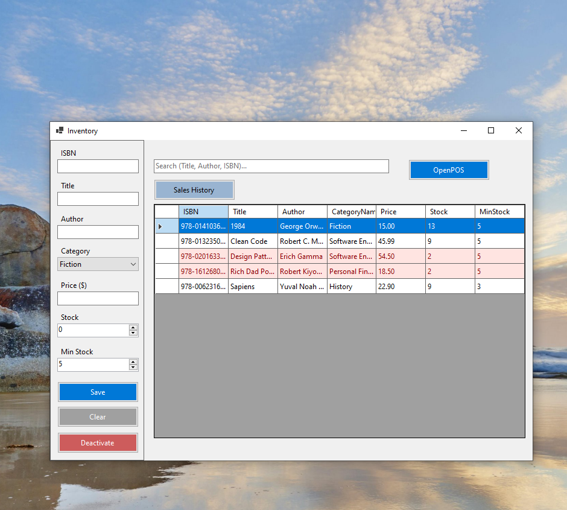
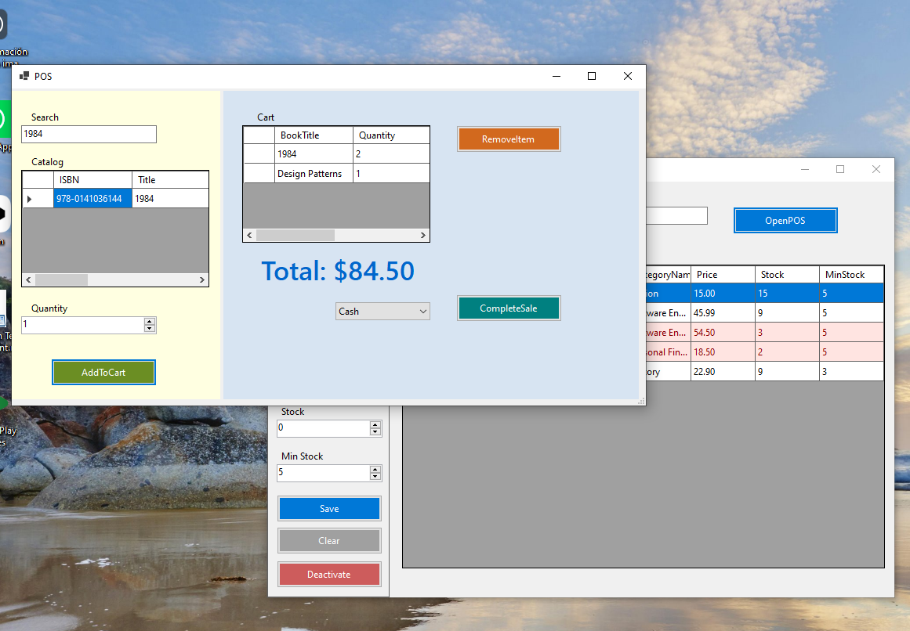
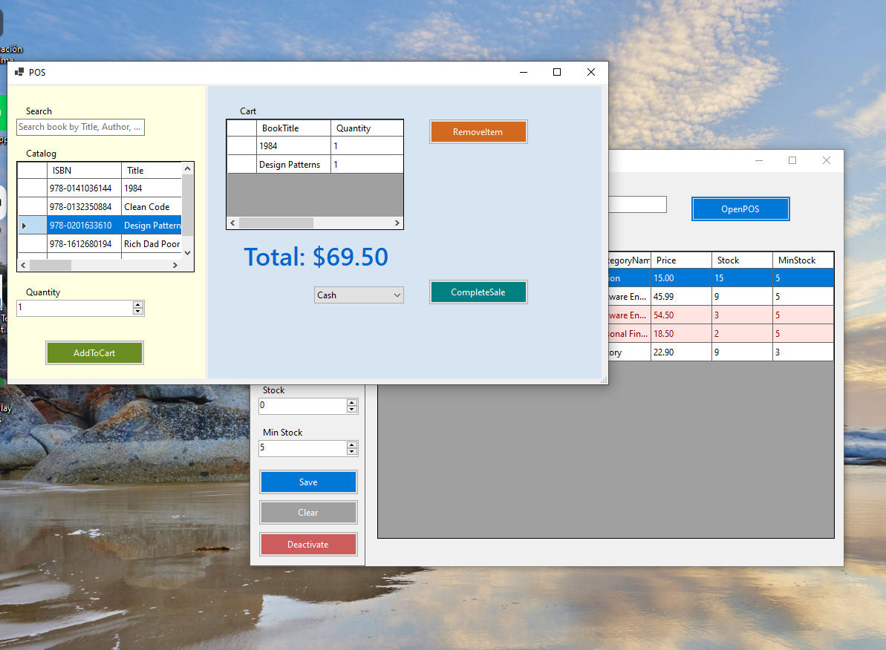
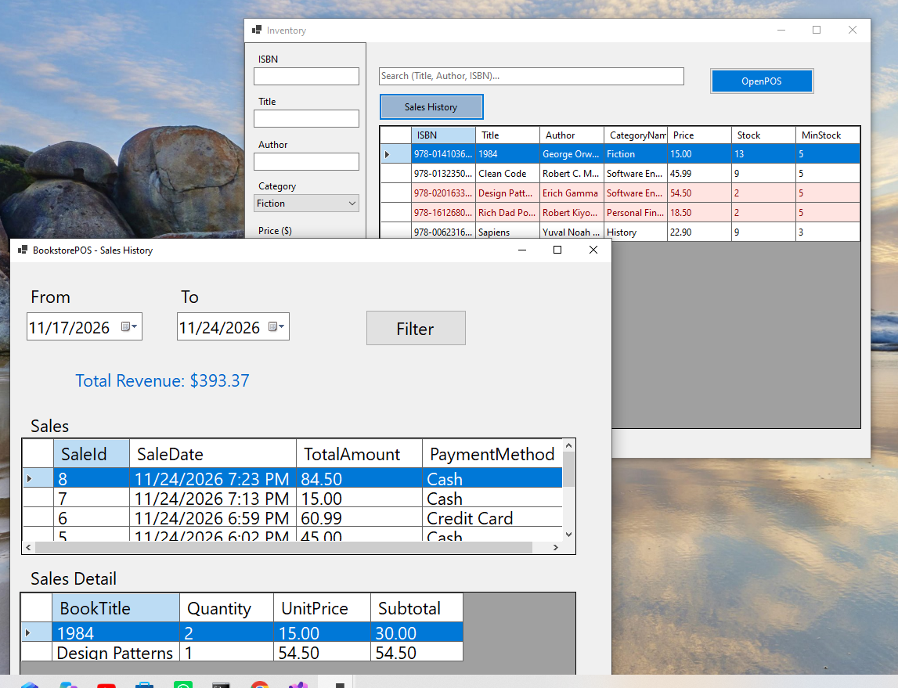

# BookstorePOS — Point of Sale & Inventory Management System

A desktop **Point of Sale (POS)** and **Inventory Management** application for a bookstore, built with **C#**, **Windows Forms (.NET 10)** and **SQL Server (LocalDB)** using a **3-tier architecture** and **ADO.NET** (`Microsoft.Data.SqlClient`).

## Key Features

- **Inventory Management (`FrmInventory`):** full CRUD for books with real-time search by Title, Author or ISBN, soft-delete (`IsActive = 0`) to preserve historical sales records, and automatic row highlighting in red when `Stock <= MinStock`.
- **Point of Sale (`FrmPOS`):** live catalog search, shopping cart with stock validation, automatic total calculation and payment method selection (Cash, Debit Card, Credit Card, Transfer).
- **Atomic SQL transactions:** sale registration (`Sales`, `SaleDetails` and the `Books` stock deduction) runs inside a single `SqlTransaction`, with automatic rollback on failure or insufficient stock.
- **Sales History (`FrmSalesHistory`):** date-range filtering (From / To), total revenue summary and a master–detail view showing the books sold in each transaction.

## 3-Tier Architecture

The solution (`BookstorePOS.slnx`) separates responsibilities into four projects with one-way dependencies (`BookstorePOS.UI` → `BLL` → `DAL` → `Entities`):

| Project | Layer | Responsibility |
|---|---|---|
| `BookstorePOS.UI` | Presentation | WinForms screens (`FrmInventory`, `FrmPOS`, `FrmSalesHistory`) and `App.config` |
| `BLL` | Business Logic | Input validation, stock rules and total calculations before calling the DAL |
| `DAL` | Data Access | `DbConnection`, parameterized ADO.NET queries, `INNER JOIN`s and `SqlTransaction` |
| `Entities` | Domain Models | Plain C# classes (`Book`, `Category`, `Sale`, `SaleDetail`) shared across layers |

## Database Schema (`BookstoreDB`)

- **Categories:** book categories with soft-delete support.
- **Books:** catalog with unique ISBN, Price, Stock, MinStock and a foreign key to Categories.
- **Sales:** sale header with SaleDate, TotalAmount and PaymentMethod.
- **SaleDetails:** line items storing the historical UnitPrice and a persisted computed Subtotal (`Quantity * UnitPrice`).

## Screenshots

### Inventory Management & Low-Stock Alerts


### Point of Sale — Live Search & Cart


### Point of Sale — Checkout


### Sales History & Master–Detail View


## Setup & Installation

### Prerequisites

- Windows 10 / 11
- [Visual Studio](https://visualstudio.microsoft.com/) with the **.NET desktop development** workload and support for **.NET 10**
- SQL Server Express or SQL Server LocalDB (`(localdb)\MSSQLLocalDB`)

### Steps to Run

1. **Clone the repository:**

   ```bash
   git clone https://github.com/Hans-Rafael/bookstore-pos-winforms.git
   ```

2. **Create the database:** open `database.sql` (in the repository root) in SQL Server Management Studio (SSMS) or Visual Studio's SQL editor, connected to `(localdb)\MSSQLLocalDB`, and execute it. The script creates `BookstoreDB`, its four tables (`Categories`, `Books`, `Sales`, `SaleDetails`) and inserts sample categories and books.

3. **Verify the connection string:** open `BookstorePOS.UI/App.config` and confirm that the `BookstoreDB` connection string matches your local SQL Server instance:

   ```xml
   <connectionStrings>
     <add name="BookstoreDB"
          connectionString="Server=(localdb)\MSSQLLocalDB;Database=BookstoreDB;Integrated Security=True;TrustServerCertificate=True;" />
   </connectionStrings>
   ```

4. **Build and run:** open `BookstorePOS.slnx` in Visual Studio, set `BookstorePOS.UI` as the Startup Project and press **F5**.
